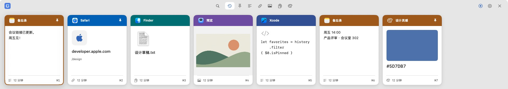
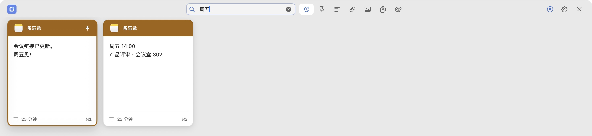
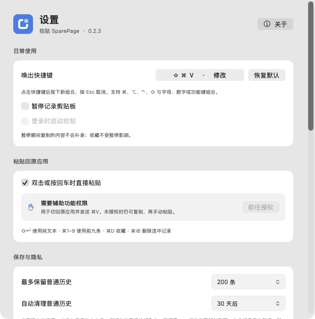
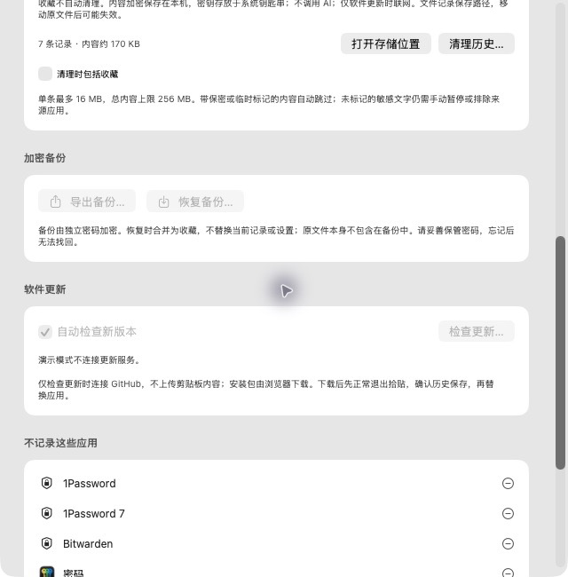

# 拾贴 · SparePage

**每一次复制，都值得被记住。**

Clipboard Manager for macOS · 免费 macOS 工具 · 开发者 Jeremy Wang

拾贴把日常复制变成 Mac 上的一份随手备忘录。寄件时连续复制地址和手机号，按 **⇧⌘V** 即可逐条取用。常用的收货地址、会议链接和开票信息可以点图钉收藏。下次需要，搜几个字就能贴回输入框。

[产品官网](https://wlei24.github.io/sparepage-releases/) · [下载看板](https://wlei24.github.io/sparepage-releases/stats.html) · [下载最新正式版](https://github.com/wlei24/sparepage-releases/releases/latest) · [安装与权限指引](#安装与权限指引) · [问题反馈](https://github.com/wlei24/sparepage-releases/issues) · [免责声明](#免责声明)

> **系统要求：Apple Silicon Mac（M 系列芯片），macOS 14 或更新版本。** 当前不提供 Intel 安装包。正式版尚未经过 Apple Developer ID 签名与公证，首次打开或升级时可能需要由你确认系统提示。

## 从 v0.2.4 到 v0.2.5

- **区域截图。** 框选后可移动和调整大小，在选区旁复制图片或保存 PNG。悬停图标可看操作说明。
- **本机识字。** 需要文字时点击「识字」，核对后直接复制。历史中的图片也可以提取文字。
- **整理信息。** 把多条消息整理为收货地址、工作待办或自定义字段的表格，核对后再复制。接入指引支持本机 Ollama、OpenAI 兼容接口及 Claude 格式的云端模型。

## 功能一览

### 复制内容，变成看得见的历史

文字、链接、图片、文件记录统一展示为卡片。卡片保留来源应用、内容预览、复制时间，以不同颜色区分来源，便于快速辨认。

- **文字与代码**：预览正文，保留复制内容；需要时使用纯文本粘贴。
- **链接**：用域名和路径帮助识别，不必只看一长串地址。
- **图片**：直接查看缩略图，找到要重复使用的画面。
- **文件**：记录文件位置，支持再次复制文件引用；不额外备份原文件。
- **展开与收起**：列表浮在屏幕底部，点击外部区域即可收起；按住卡片左右拖动或使用触控板横向滚动，浏览更多内容。

### 找到那一条，少翻几次

点击搜索图标或按 **⌘F** 展开搜索框，可以搜索文字、文件名和来源应用。类型筛选帮助聚焦文字、链接、图片等内容；常用片段可以收藏，之后从收藏入口快速找回。

收藏不会被普通历史的定期清理自动删除。普通历史可设置保留数量与过期清理时间，让列表保持好找。

### 顺手的快捷键，清楚的设置

唤出快捷键可以自行录制。授权后，双击卡片或按回车即可将内容粘贴回之前的输入框；不授权自动粘贴，也能把内容复制后手动使用。

| 操作 | 默认方式 |
| --- | --- |
| 唤出历史列表 | ⇧⌘V，可在设置中修改 |
| 搜索 | 点击搜索图标，或在列表内按 ⌘F |
| 使用选中内容 | 双击卡片或回车 |
| 以纯文本使用 | ⇧↵ |
| 使用前九条内容 | ⌘1–9 |
| 收藏 / 取消收藏 | ⌘D |
| 删除选中记录 | ⌘⌫ |
| 浏览更多卡片 | 鼠标按住卡片左右拖动，或触控板横向滚动 |

菜单栏提供打开、暂停、设置、检查更新、关于和退出入口。暂停期间复制的内容不会在恢复后补录。

### 本机保存，备份由你掌握

- **本机加密**：历史使用 AES-GCM 加密，密钥保存在当前 Mac 的系统钥匙串中。
- **密码备份**：在设置中导出加密备份；恢复时合并为收藏并跳过重复内容，不覆盖现有历史和设置。
- **隐私控制**：可以暂停记录、排除来源应用；带保密或临时标记的内容会被跳过。系统锁屏、睡眠或切换会话期间暂停采集。
- **明确边界**：文件记录仅引用原路径；备份不包含这些原文件。恢复镜像只保存当前状态，不是历史版本备份。
- **更新提醒**：默认每天自动检查一次 GitHub 新版，也可手动检查。由你选择打开下载页、稍后或跳过版本，应用不会静默替换自身。

介绍图来自应用的独立演示模式，不包含真实用户的剪贴板内容。演示模式会停用授权、备份和联网按钮，因此图中这些按钮呈灰色；安装后的正常模式可使用相应功能。界面显示与可用系统权限可能随 macOS 版本略有差异。

## 安装与权限指引

### 1. 安装到“应用程序”

在 [Release 页面](https://github.com/wlei24/sparepage-releases/releases/latest) 下载 `.dmg`，打开后把 **拾贴.app** 拖入 **Applications**。复制完成后，从“应用程序”启动拾贴，再推出安装磁盘。

请下载 Assets 中的 DMG。GitHub 自动生成的 **Source code（zip / tar.gz）** 只是本说明仓库的打包文件，不是应用安装包，也不包含应用源码。

如果 macOS 提示无法验证开发者：先确认下载来自本仓库，再参阅 [Apple 关于安全打开 Mac App 的说明](https://support.apple.com/zh-cn/102445)，由你决定是否允许这个特定应用打开。不需要关闭 Gatekeeper、SIP 或其他系统安全保护。如果提示包含恶意软件警告，请停止打开并反馈。

### 2. 开启辅助功能——用于双击自动粘贴

1. 进入拾贴 **设置 → 粘贴回原应用**，开启“**双击或按回车时直接粘贴**”。
2. 点击“**前往授权**”；或手动打开 **苹果菜单 → 系统设置 → 隐私与安全性 → 辅助功能**。
3. 找到 **拾贴** 并开启开关。列表没有拾贴时，点击 **＋**，从 **应用程序** 中选择当前的 **拾贴.app**。如系统要求，使用 Touch ID 或 Mac 登录密码确认。
4. 回到拾贴，确认显示“**辅助功能已授权**”。如状态未刷新，正常退出并重新打开拾贴。
5. 先在备忘录等应用里点击一个可编辑输入框，再用快捷键唤出拾贴，双击一条普通文字进行验证。

辅助功能允许应用与其他应用交互。拾贴用它切回原应用并发送粘贴快捷键；是否开启由你决定，可随时在系统设置中撤销。**不授权时可以复制历史内容，再回到输入框按 ⌘V。**

官方参考：[Apple：允许辅助功能 App 访问 Mac](https://support.apple.com/guide/mac-help/mh43185/mac)。

### 3. 剪贴板、钥匙串和登录项分别有什么作用

| 项目 | 作用与选择 |
| --- | --- |
| 剪贴板读取 / 粘贴提示 | 用来读取新复制的内容。若系统询问是否允许拾贴读取或粘贴，请按自己的意愿选择；拒绝后新内容可能无法进入历史。具体提示和设置入口以当前 macOS 为准，并非所有版本都有独立开关。 |
| 辅助功能 | 用于双击或回车时自动粘贴回原应用；不授权仍可手动粘贴。 |
| 钥匙串访问 | 用于读取本机历史加密密钥。首次使用或临时签名版本升级后可能出现提示；只在确认是可信的当前拾贴时允许。不要删除原密钥来“修复”历史问题。 |
| 登录时启动 | 可选。在拾贴设置中按需开启，系统若要求确认，可在“通用 → 登录项”相关页面查看。 |

拾贴的常规使用不要求你为了自动粘贴而开启屏幕录制、摄像头、麦克风或完全磁盘访问。

### 已开启权限，但双击还是没反应？

按以下顺序检查：

1. 确认“**双击或按回车时直接粘贴**”已开启，并先点击目标输入框，再唤出列表。
2. 查看拾贴自身是否显示“**辅助功能已授权**”，不要只看系统列表里的开关。
3. 如果更新后系统显示已开、拾贴仍显示未授权，先正常退出拾贴。在系统“辅助功能”列表移除旧条目，再用 **＋** 添加“应用程序”里的当前 **拾贴.app** 并开启，然后重新启动应用。只移除权限条目，不要删除历史数据或钥匙串。
4. 使用备忘录的普通文字输入框复测。部分应用、密码框或受保护界面可能不接受模拟粘贴；可先手动按 ⌘V 验证。
5. 仍有问题，请在 Issues 中提供应用版本、macOS 版本、目标应用及操作步骤；不要上传私人内容、密码或密钥。

## 迁移与数据保留

**正常升级只替换应用，不会清理历史、收藏或设置。** 下载新版后正常退出拾贴，将新版拖入 Applications 替换，再重新打开即可。记录仍按你设置的保留数量和期限管理；升级本身不执行清理或重置。

更换电脑或重装系统时，先在设置中导出密码加密备份，并妥善保存备份密码；在新电脑安装拾贴后，通过“恢复备份”导入。恢复会合并为收藏，跳过重复内容，不覆盖当前历史和设置。文件记录仅保留原路径，原文件需要另行迁移。

本机数据位于 `~/Library/Application Support/SparePage/`，加密备份扩展名为 `.sparepagebackup`。

**不要用卸载清理工具删除数据目录或系统钥匙串。** 仅复制应用或数据目录不能替代加密备份；加密历史需要对应密钥才能读取。

## 隐私与网络

历史加密保存在本机，截图识字由本机完成。使用 AI 整理时，仅在你确认后向所选模型发送本次选中的原文和字段。应用不收集遥测。检查更新时连接 GitHub，安装包由浏览器下载；GitHub 会处理提供下载与更新服务所需的网络请求。可在设置中关闭自动检查更新。

应用无法识别所有敏感文字。复制密码、密钥、验证码、客户资料等敏感内容前，请按需要暂停记录或排除来源应用。加密不能防止已控制当前登录会话的恶意程序读取正在使用的内容。

## 免责声明

1. **免费体验软件，按现状提供。** 可能存在缺陷、兼容性问题或功能调整，不承诺持续更新、不中断运行、满足所有特定用途或绝对安全。免费提供不代表已通过 Apple 安全审查。
2. **剪贴板历史不能替代可靠备份。** 强制退出、断电、磁盘故障、误删、清理操作及系统变化可能造成内容丢失。请自行备份重要资料，并在更换电脑或重装系统前导出加密备份。丢失钥匙串密钥且无可用备份时，无法解密原历史。
3. **请合法使用并确认内容权限。** 仅复制、保存和分享你有权处理的内容；涉及个人信息、商业机密或工作资料时，请遵守所在组织的要求及适用法律。
4. **责任边界。** 在适用法律允许的范围内，开发者不对因使用或无法使用本体验软件导致的数据丢失、业务中断等间接损失承担责任。本说明不影响用户依法享有的权利，也不排除依法不得免除的责任。
5. **第三方名称与图标。** 来源应用的名称和图标仅用于识别内容来源，相关权利归各自权利人；不代表这些第三方参与开发、背书或合作。

## 反馈与开发者

开发者：**Jeremy Wang** · [提交问题与建议](https://github.com/wlei24/sparepage-releases/issues/new/choose)

本仓库包含安装包发布、使用说明、产品官网和公开下载统计，**不包含应用源代码**。

## 仓库目录

| 目录 | 内容 |
| --- | --- |
| `docs/` | 产品官网首页与下载看板；GitHub Pages 从此目录发布 |
| `docs/assets/brand/` | 品牌 Logo |
| `docs/assets/screenshots/` | 功能介绍截图 |
| `docs/assets/css/` | 官网与看板的样式 |
| `docs/assets/js/` | 官网交互与看板逻辑 |
| `data/` | 公开的安装包下载汇总和历史快照 |
| `.github/workflows/` | 每日下载统计自动任务 |
| `.github/ISSUE_TEMPLATE/` | 问题反馈与功能建议表单 |
| `tests/` | 官网版本同步逻辑检查 |

安装包在 [Releases](https://github.com/wlei24/sparepage-releases/releases) 中维护，不放入网页目录。下载看板展示 GitHub 安装包下载次数，不代表独立安装人数；没有收集安装者身份或剪贴板内容。

维护页面时修改 `docs/` 中的对应文件。统计任务继续写入 `data/downloads.json`，保留已有历史。GitHub Pages 发布设置为 `main` 分支的 `/docs` 目录，官网与看板访问地址保持不变。

© 2026 Jeremy Wang

### 官网版本与反馈维护

官网打开时通过 GitHub 官方接口读取最新稳定发布，只有对应的 Apple Silicon DMG 上传完成后才显示版本号与直达下载。网络异常、访问限额或附件未就绪时保留「最新发布页」入口；不把旧版本固定为默认下载。版本说明链接同步指向对应的发布记录，无需每次手动修改网页。

应用的后续版本在「关于」提供反馈入口和可预览、可复制的诊断摘要，仅包含应用版本、macOS 版本、架构和权限状态，不包含历史或复制正文，也不自动提交。旧版用户可以在反馈表单中手动填写。

维护检查：在仓库目录运行 `node --test tests/website-release.test.cjs`。
